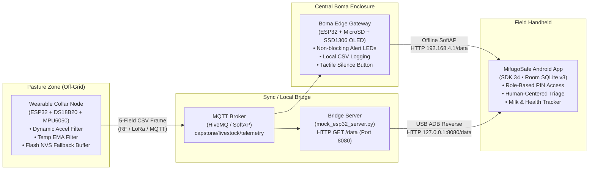
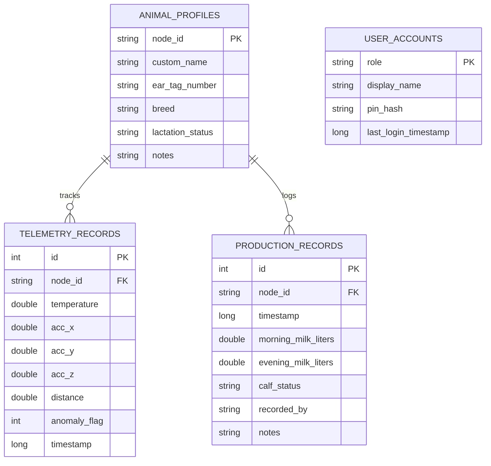

# MifugoSafe 🐄📡
### Human-Centered, Offline-First Smart Herd & Field Veterinary Monitoring System

[-0F2942.svg)](https://developer.android.com/)
[](https://developer.android.com/training/data-storage/room)
[-D97706.svg)](https://material.io/)
[](https://wokwi.com/)

**MifugoSafe** is an end-to-end, offline-first IoT and mobile health platform engineered for harsh, sunlit, and connectivity-deprived East African rangelands (such as Kenya's pastoralist corridors). 

The system bridges low-power wearable livestock telemetry, edge gateway alert processing, and a dual-persona Android application designed around **Don Norman's Principles of Human-Centered Design (HCD)** and **Jakob Nielsen's Usability Heuristics**. It translates raw physiological sensor telemetry into actionable, culturally accessible pastoralist care and clinical veterinary diagnostics without requiring an active internet connection.

---

## 📑 Table of Contents
1. [System Architecture & Data Flow](#-system-architecture--data-flow)
2. [Hardware Subsystems](#-hardware-subsystems)
   - [A. Wearable Collar Node (`wearable-node/`)](#a-wearable-collar-node-wearable-node)
   - [B. Boma Edge Gateway (`edge-gateway/`)](#b-boma-edge-gateway-edge-gateway)
3. [Android Application (`vet-client-app/`)](#-android-application-vet-client-app)
   - [Dual-Persona Role Architecture](#dual-persona-role-architecture)
   - [Human-Centered Design (HCD) & Ergonomics](#human-centered-design-hcd--ergonomics)
   - [Livestock Output & Milk Production Tracker](#livestock-output--milk-production-tracker)
   - [Offline Local Database Schema (Room SQLite v3)](#offline-local-database-schema-room-sqlite-v3)
4. [Wokwi Simulation & Local Gateway Bridge (`mock-gateway/`)](#-wokwi-simulation--local-gateway-bridge-mock-gateway)
5. [Telemetry Payload Schemas](#-telemetry-payload-schemas)
6. [Quick Start & Setup Guide](#-quick-start--setup-guide)
   - [Prerequisites](#prerequisites)
   - [Running Wokwi Simulations](#running-wokwi-simulations)
   - [Running the Local Gateway Bridge](#running-the-local-gateway-bridge)
   - [Building & Installing the Android App](#building--installing-the-android-app)

---

## 🏛 System Architecture & Data Flow



### Complete End-to-End Workflow:
1. **Sensing & Filtering:** The wearable collar node samples digital core temperature and 3-axis motion every 2.5 seconds, running real-time Exponential Moving Average (EMA) smoothing and gravity compensation.
2. **Event-Driven Anomaly Detection:** Anomaly flags (`1 = Fever/Calving`, `2 = Straying >500m`, `3 = Predator/Panic >14m/s²`) trigger immediate telemetry transmission. If connection is lost, frames are safely buffered into non-volatile flash memory (`Preferences`).
3. **Edge Gateway Processing:** The central Boma Gateway receives the telemetry, displays herder status on an SSD1306 OLED screen, drives pattern-encoded emergency LEDs (800ms amber pulse, 400ms red blink, 150ms strobe), and logs records to an onboard MicroSD card.
4. **Offline Mobile Sync:** Field herders and visiting veterinarians tap a 56dp CTA button in the Android app to sync records over local Wi-Fi or USB bridge into Room SQLite—requiring **zero cellular data or internet connection**.

---

## ⚡ Hardware Subsystems

### A. Wearable Collar Node (`wearable-node/`)
Engineered with ESP32-based low-power firmware located in [`wearable-node/src/main.cpp`](wearable-node/src/main.cpp).

* **Thermal Sensing & EMA Filtering:** Utilizes a Maxim DS18B20 digital 1-Wire temperature sensor. Incorporates an Exponential Moving Average (EMA, $\alpha = 0.6$) filter to eliminate ambient thermal spikes and CRC disconnection artifacts (`-127°C` / `+85°C`).
* **Gravity-Compensated Dynamic Acceleration:** Reads an MPU-6050 6-DOF IMU over I2C. Computes dynamic vector acceleration:
  $$\text{Dynamic Accel} = \left|\sqrt{a_x^2 + a_y^2 + a_z^2} - 9.81\right| \text{ m/s}^2$$
  This prevents false distress alerts caused by standard grazing posture or neck-tilting.
* **Geofence Proximity Sensing:** An analog voltage divider simulates radio frequency / RSSI distance mapping from `0` to `1000` meters from the central Boma anchor.
* **NVS Flash Memory Fallback:** If the network link drops, up to 20 emergency telemetry packets are preserved in non-volatile flash memory (`Preferences`). When the link is restored, backlogged packets stream automatically to prevent data loss.

### B. Boma Edge Gateway (`edge-gateway/`)
Firmware located in [`edge-gateway/src/main.cpp`](edge-gateway/src/main.cpp).

* **MicroSD File Logger:** Automatically mounts an SPI MicroSD card and appends synchronized CSV records to `/livestock.csv`.
* **Non-Blocking Pattern-Encoded Alert Matrix:**
  * **Health / Fever / Calving Drop (Flag 1):** Steady `800ms` pulse on Amber LED.
  * **Geofence Perimeter Breach (>500m, Flag 2):** Medium `400ms` blink on Red LED.
  * **Predator Harassment / Theft Spike (Flag 3):** Rapid alternating `150ms` strobe on Red & Amber LEDs.
* **Alert Fatigue Acknowledgment Button:** Hardware tactile switch on GPIO 27 allows herders to silence visual alerts after attending to an animal, dumping current SD logs to the serial console without rebooting.
* **Local Visual OLED:** 0.96-inch SSD1306 (128×64) I2C display displays real-time triage summaries at the Boma enclosure.

---

## 📱 Android Application (`vet-client-app/`)

The Android application is written in Java (Android SDK 34, Material 3, Room SQLite ORM, OkHttp3) and built with strict adherence to human factors and field usability in semi-arid environments.

### Dual-Persona Role Architecture

```
                       ┌───────────────────────────────┐
                       │     MifugoSafe Offline PIN    │
                       │     & Role Login Screen       │
                       └──────────────┬────────────────┘
                                      │
                 ┌────────────────────┴────────────────────┐
                 ▼                                         ▼
      [ 👨🏾‍🌾 ROLE_FARMER ]                       [ 🩺 ROLE_VET ]
      Default PIN: 1234                         Default PIN: 9999
   • Real cow names & ear tags               • Raw 3-axis vectors (|a|, X/Y/Z)
   • Plain-language care steps               • Clinical differential diagnosis
   • Zero technical metrics                  • Pharmacological protocols
   • Daily milk yield logging                • Gateway IP / endpoint config
```

* **Offline SHA-256 PIN Security (`AuthManager.java`):** 100% offline local authentication. 4-digit PINs are verified against SHA-256 password hashes stored in `SharedPreferences` and Room SQLite.
* **Demo Quick Login:** Includes a 1-tap presentation bypass switch for academic defenses and live evaluations.

---

### Human-Centered Design (HCD) & Ergonomics

| HCD Dimension | Implementation in MifugoSafe |
|---|---|
| **Norman's Affordances & Signifiers** | High-contrast status pills, tactile PIN keypad circles, 8dp urgency accent strips (Red, Amber, Green). |
| **Fitts's Law Touch Targets** | All interactive buttons, segmented role switches, and filter chips have a minimum height of **56dp** with 12dp spacing for reliable one-handed thumb use while walking in pastures. |
| **Outdoor Daylight Contrast** | Pure white card surfaces (`#FFFFFF`) on a warm stone daylight background (`#F4F5F7`) with deep slate typography (`#111827`) for direct equatorial sunlight legibility. |
| **System & Real-World Match** | Technical jargon like `14.8 m/s²` or `HTTP GET 192.168.4.1` is eliminated for herders and replaced with real cow identities, intuitive visual progress bars, and plain language (*"🔥 Body is very hot (40.2°C). Keep in shade and call vet."*). |

---

### Livestock Output & Milk Production Tracker

* **Economic Output Logging (`ProductionRecord.java`):** Herders log morning and evening milk production (Liters), pregnancy/calving milestones (`Normal`, `Expecting Soon`, `Calved`), and general observations.
* **Health-to-Yield Correlation Engine:** When physiological telemetry detects an anomaly (e.g. Fever `temp > 39.5°C`), the application automatically surfaces an actionable insight banner:
  > *"⚠️ Fever detected! Expect temporary milk drop. Check udder for mastitis."*

---

### Offline Local Database Schema (Room SQLite v3)



---

## 🌐 Wokwi Simulation & Local Gateway Bridge (`mock-gateway/`)

Since Wokwi simulates ESP32 hardware inside a browser sandbox, [`mock-gateway/mock_esp32_server.py`](mock-gateway/mock_esp32_server.py) serves as a bidirectional communication bridge:

1. **Subscribes to HiveMQ:** Connects to `broker.hivemq.com:1883` on topic `capstone/livestock/telemetry`.
2. **Buffers Real Wokwi Telemetry:** Receives live collar node sensor readings, parses dynamic motion, distance, and temperature, and stores them in memory.
3. **Local HTTP Server:** Exposes an endpoint at `http://0.0.0.0:8080/data` returning formatted CSV telemetry to the mobile app.
4. **USB Port Reverse Forwarding:** Using `adb reverse tcp:8080 tcp:8080`, your connected Android device accesses the live bridge directly at `http://127.0.0.1:8080/data` without needing local LAN Wi-Fi configuration.

---

## 📊 Telemetry Payload Schemas

The mobile client's tolerant parser ([`Esp32SyncClient.java`](vet-client-app/app/src/main/java/com/livestock/vetclient/network/Esp32SyncClient.java)) parses both firmware formats:

### 1. 5-Field Firmware Schema (Standard Wokwi & Collar Node)
```csv
NODE_ID,TEMP,DYNAMIC_ACCEL,DISTANCE,ANOMALY_FLAG
NODE_001,40.20,1.40,220,1
```

### 2. 8-Field Unified CSV Schema
```csv
NODE_ID,TEMP,ACC_X,ACC_Y,ACC_Z,DISTANCE,ANOMALY_FLAG,TIMESTAMP
NODE_001,39.50,0.80,0.20,9.80,180.0,0,1727169615
```

### Anomaly Flag Definitions:
| Flag | Semantic State | Trigger Conditions | LED Indicator |
|:---:|:---|:---|:---|
| **0** | **Healthy (Salama)** | $38.0^\circ\text{C} \le \text{Temp} \le 39.5^\circ\text{C}$, $\text{Dist} \le 500\text{m}$, $\text{Accel} \le 14\text{ m/s}^2$ | LEDs Off |
| **1** | **Health Alert (Homa / Kuzaa)** | Pyrexia ($\text{Temp} > 39.5^\circ\text{C}$) or Calving Drop ($< 37.8^\circ\text{C}$) | Amber 800ms Pulse |
| **2** | **Geofence Breach (Imetoroka)** | Pasture boundary breach ($\text{Distance} > 500\text{m}$) | Red 400ms Blink |
| **3** | **Predator / Panic (Hatari)** | Violent dynamic acceleration spike ($> 14.0\text{ m/s}^2$) | Red & Amber 150ms Strobe |

---

## 🚀 Quick Start & Setup Guide

### Prerequisites
* **Android Development:** Android Studio Hedgehog+ (or JDK 17+ and Android SDK 34 platform tools).
* **Embedded IoT:** PlatformIO Core / VS Code extension (or Arduino IDE with ESP32 board support).
* **Python Environment:** Python 3.9+ with `paho-mqtt` (`pip install paho-mqtt`).
* **Wokwi:** Free account on [wokwi.com](https://wokwi.com).

---

### Running Wokwi Simulations
1. Open [`wearable-node/`](wearable-node/) on Wokwi or flash [`wearable-node/src/main.cpp`](wearable-node/src/main.cpp) to an ESP32 board.
2. In the simulation, adjust the DS18B20 slider (temperature) or potentiometer (distance).
3. Observe real-time MQTT alerts published to `broker.hivemq.com` on topic `capstone/livestock/telemetry`.

---

### Running the Local Gateway Bridge
In your PC terminal, launch the bridge:

```powershell
# Navigate to the bridge directory
cd mock-gateway

# Start the bridge
python mock_esp32_server.py
```

If your Android phone is connected to your PC via USB with USB debugging enabled, route the port:

```powershell
adb reverse tcp:8080 tcp:8080
```

---

### Building & Installing the Android App

#### Option 1: Via Gradle Command Line
```powershell
cd vet-client-app

# Build debug APK and run unit tests
.\gradlew.bat assembleDebug testDebugUnitTest

# Install directly to your connected Android device
adb install -r app\build\outputs\apk\debug\app-debug.apk
```

#### Option 2: Via Android Studio
1. Open the [`vet-client-app/`](vet-client-app/) folder in Android Studio.
2. Sync Gradle files.
3. Select your connected phone or emulator and click **Run (Shift + F10)**.

---

### Testing with the Mobile App
1. **Login:** Launch **MifugoSafe** on your phone.
   * **Herder Mode:** Tap `[ 👨🏾‍🌾 Cow Owner / Herder ]` and enter PIN `1234` (or tap **⚡ Demo Quick Login**).
   * **Vet Mode:** Tap `[ 🩺 Field Veterinarian ]` and enter PIN `9999`.
2. **Sync Herd:** Tap the green **"🔄 Update Herd Status"** button. The app will pull live readings directly from Wokwi over `http://127.0.0.1:8080/data`.
3. **Triage & Detail:** Tap **"🔍 View Health"** to view real-time visual progress gauges, complete action checklists, and log milk yields.

---

## 📜 Academic Attribution & License
Developed as part of the **Bachelor of Science in Informatics and Computer Science (ICS Project II)** at Strathmore University.

* **Author:** Tevin Tajeu
* **License:** Licensed under the [Apache License 2.0](LICENSE).

